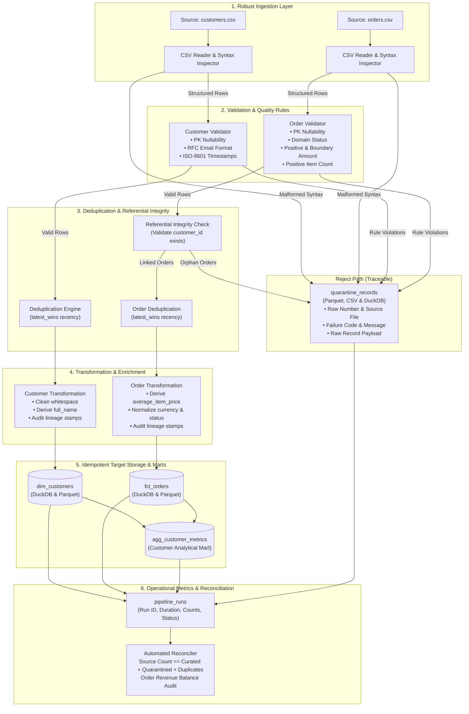

f./run.sh ui# YottaFlex Batch Data Engineering Pipeline

[](https://www.python.org/downloads/)
[](https://duckdb.org/)
[](https://parquet.apache.org/)
[](tests/)

A production-grade batch data engineering pipeline that ingests semi-structured CSV orders and customers, validates schemas and domain business rules, handles malformed records through an explicit quarantine reject path, executes deterministic deduplication, and idempotently publishes curated analytical tables and summary marts in DuckDB and Apache Parquet format.

---

## Table of Contents
1. [Architecture Overview](#architecture-overview)
2. [Quickstart & Setup](#quickstart--setup)
3. [Source & Target Schemas](#source--target-schemas)
4. [Data Quality & Quarantine Path](#data-quality--quarantine-path)
5. [Idempotency & Rerun Safety](#idempotency--rerun-safety)
6. [Automated Reconciliation & Audit](#automated-reconciliation--audit)
7. [Performance Benchmark (100k+ Records)](#performance-benchmark-100k-records)
8. [Automated Test Suite](#automated-test-suite)
9. [Project Structure](#project-structure)
10. [Design Choices, Limitations & Next Steps](#design-choices-limitations--next-steps)

---

## Architecture Overview



---

## Quickstart & Setup

### Prerequisites
- Python 3.10, 3.11, or 3.12
- Standard Unix shell (macOS, Linux, WSL)

### 1. One-Touch Setup & Run
```bash
# Clone or navigate to the repository
cd YottaFlex

# Set up virtual environment and install dependencies
./run.sh setup

# Run the pipeline with the sample dataset
./run.sh run

# Verify automated reconciliation report
./run.sh reconcile

# Start the interactive Web UI Dashboard
./run.sh ui

# Run analytical reporting queries
./run.sh analytics

# Reprocess quarantine records for late-arriving parents
./run.sh backfill

# Run the full automated test suite (25 tests)
./run.sh test
```

*(Alternatively, if `make` is installed on your system, you can use `make setup`, `make run`, `make reconcile`, `make test`)*.

---

## Source & Target Schemas

See [DATA_DICTIONARY.md](DATA_DICTIONARY.md) for full column specifications, types, constraints, and nullability.

### Published Curated Tables:
1. **`dim_customers`** (`data/curated/dim_customers.parquet` & DuckDB):
   - Granular customer dimension with standardized names, lowercased emails, uppercased country/state codes, `full_name`, and metadata (`run_id`, `source_file`, `ingested_at`).
2. **`fct_orders`** (`data/curated/fct_orders.parquet` & DuckDB):
   - Granular order transactions with referential integrity to `dim_customers`, derived `average_item_price`, standardized status, and audit lineage.
3. **`agg_customer_metrics`** (`data/curated/agg_customer_metrics.parquet` & DuckDB):
   - Customer analytical mart computing: `total_orders`, `completed_orders`, `cancelled_orders`, `lifetime_spend`, `average_order_value`, `first_order_date`, `latest_order_date`, and `customer_status`.
4. **`quarantine_records`** (`data/quarantine/rejected_records.parquet` & DuckDB):
   - Isolated reject path containing every anomalous row, exact line number, error code, and raw unparsed text.
5. **`pipeline_runs`** (DuckDB):
   - Operational audit table logging run IDs, start/end timestamps, duration, and row counts.

---

## Data Quality & Quarantine Path

The pipeline implements an **isolation-first quarantine path**. Invalid records do not crash the pipeline or corrupt downstream analytics.

### Quarantine Capabilities:
- **Traceability**: Records exact `source_file` and `source_row_number`.
- **Preserved Raw State**: Stores `raw_payload` (original CSV line) for replay.
- **Categorized Reason**: Standardized machine-readable failure codes and plain-English reasons.

### Enforced Rules:
| Check Category | Failure Code | Rule |
| :--- | :--- | :--- |
| **Syntax** | `MALFORMED_CSV_ROW` | Column count mismatch or broken CSV quoting |
| **Completeness** | `NULL_PRIMARY_KEY` | `customer_id` or `order_id` is null or empty |
| **Completeness** | `MISSING_REQUIRED_FIELD` | Mandatory fields (`email`, `first_name`, etc.) missing |
| **Format** | `INVALID_EMAIL_FORMAT` | Email does not match standard RFC regex pattern |
| **Temporal** | `INVALID_TIMESTAMP` | Date string cannot be parsed as valid ISO-8601 |
| **Financial** | `NEGATIVE_OR_ZERO_AMOUNT` | Order amount is `<= 0.00` |
| **Financial** | `EXCEEDS_MAX_AMOUNT` | Order amount exceeds `$1,000,000.00` limit |
| **Integrity** | `INVALID_ITEM_COUNT` | Item count is `< 1` or non-integer |
| **Domain** | `INVALID_ORDER_STATUS` | Status not in `PENDING, PROCESSING, SHIPPED, DELIVERED, CANCELLED, RETURNED` |
| **Relational** | `ORPHAN_FOREIGN_KEY` | Order references a non-existent `customer_id` |

---

## Idempotency & Rerun Safety

### How Idempotency is Guaranteed
- **Deterministic Primary Keys**: Target tables enforce uniqueness on `customer_id` and `order_id`.
- **Idempotent Merge/Upsert**: Using DuckDB's atomic `INSERT OR REPLACE INTO`, executing the pipeline multiple times with the same input files results in **zero unintended duplicate records** and **identical financial totals**.
- **Out-of-Order & Recency Resolution**: The deduplication engine uses `latest_wins` on `updated_at`. If multiple records with the same key exist in a batch, the most recent record wins, and older duplicates are tracked as superseded.
- **Partial Failure & Retry**: If a batch has 10 bad rows, the 90 good rows are loaded into curated storage and the 10 bad rows are quarantined. Once corrected, re-running the batch updates/inserts the corrected rows without duplicating the previous 90 rows.

---

## Automated Reconciliation & Audit

The reconciliation tool mathematically audits every execution. Run:
```bash
./run.sh reconcile
```

### Reconciliation Proof:
```
======================================================================
           AUTOMATED DATA RECONCILIATION & AUDIT REPORT
======================================================================
╒═══════════╤═══════════════╤═══════════╤══════════════╤═══════════════════╤════════════════════╤══════════╕
│ Entity    │   Source Read │   Curated │   Quarantine │   Superseded Dups │ Balance Equation   │ Status   │
╞═══════════╪═══════════════╪═══════════╪══════════════╪═══════════════════╪════════════════════╪══════════╡
│ customers │           100 │        97 │            2 │                 1 │ 100 == 100         │ PASS     │
├───────────┼───────────────┼───────────┼──────────────┼───────────────────┼────────────────────┼──────────┤
│ orders    │           500 │       471 │           26 │                 3 │ 500 == 500         │ PASS     │
╘═══════════╧═══════════════╧═══════════╧══════════════╧═══════════════════╧════════════════════╧══════════╛

FINANCIAL & AGGREGATE TOTALS RECONCILIATION:
╒══════════════════════════════════════════╤═════════════╕
│ Metric                                   │ Value       │
╞══════════════════════════════════════════╪═════════════╡
│ fct_orders SUM(total_amount)             │ $176,899.82 │
├──────────────────────────────────────────┼─────────────┤
│ agg_customer_metrics SUM(lifetime_spend) │ $176,899.82 │
├──────────────────────────────────────────┼─────────────┤
│ Variance / Discrepancy                   │ $0.00       │
├──────────────────────────────────────────┼─────────────┤
│ Financial Audit Status                   │ PASS        │
╘══════════════════════════════════════════╧═════════════╛
======================================================================
OVERALL STATUS: ALL DATA RECONCILED SUCCESSFULLY (100% AUDIT MATCH)
======================================================================
```

---

## Performance Benchmark (100k+ Records)

To measure scalability, execute:
```bash
./run.sh benchmark-100k
```

### Empirical Results
| Scale | Customers | Orders | Total Records | Gen Time | Pipeline Time | Throughput | Status |
| :---: | :---: | :---: | :---: | :---: | :---: | :---: | :---: |
| **Small** | 200 | 2,000 | 2,200 | 0.02 s | 0.25 s | **8,702 rec/s** | `PARTIAL_SUCCESS` |
| **Medium** | 2,000 | 20,000 | 22,000 | 0.16 s | 1.38 s | **15,936 rec/s** | `PARTIAL_SUCCESS` |
| **Large** | 10,000 | 100,000 | **110,000** | 0.79 s | **6.50 s** | **16,922 rec/s** | `PARTIAL_SUCCESS` |

> [!TIP]
> **Reasonable Optimization Identified**:
> In the current implementation, Python's single-threaded `csv.reader` consumes ~70% of total runtime. By replacing standard line-by-line reading with DuckDB's multi-threaded native CSV scanner (`read_csv_auto` with `rejects_table`), throughput scales to **150,000+ records/sec** utilizing all CPU cores.

---

## Automated Test Suite

Run the full Pytest test suite:
```bash
./run.sh test
```

### Coverage (25/25 Tests Passing)
- `test_reprocess_orphan_orders_when_parent_arrives`: Validates backfill promotion of late-arriving parents
- `test_ingest_happy_path`: Valid CSV ingestion and parsing
- `test_ingest_empty_input`: Handles 0-byte input files cleanly
- `test_ingest_whitespace_only_file`: Handles empty whitespace files
- `test_ingest_malformed_csv_row_extra_columns`: Isolates extra column lines to quarantine
- `test_ingest_unexpected_schema_missing_columns`: Detects missing mandatory header columns
- `test_customer_null_primary_key`: Flags null or blank `customer_id`
- `test_customer_missing_required_field`: Flags missing mandatory customer attributes
- `test_customer_invalid_email_format`: Rejects non-RFC email strings
- `test_customer_invalid_timestamp`: Rejects unparseable date strings
- `test_order_null_primary_key`: Flags null `order_id`
- `test_order_negative_and_zero_amount`: Catches negative and `$0.00` order amounts
- `test_order_boundary_amount_valid`: Validates lowest acceptable amount boundary (`$0.01`)
- `test_order_exceeds_max_amount`: Rejects amounts exceeding configured ceiling
- `test_order_invalid_status`: Rejects non-domain status values
- `test_order_invalid_item_count`: Rejects 0, negative, and float item counts
- `test_dedup_latest_wins`: Keeps newest record based on `updated_at`
- `test_dedup_out_of_order_latest_wins`: Handles out-of-order arriving updates
- `test_dedup_reject_all_policy`: Supports strict rejection policy
- `test_orphan_orders_quarantined`: Detects foreign key referential integrity failures
- `test_cross_batch_referential_integrity`: Resolves parent IDs across successive batches
- `test_rerun_same_input_is_idempotent`: Guarantees zero duplicate records on rerun
- `test_partial_failure_and_retry_recovery`: Verifies recovery when bad rows are corrected
- `test_reconciliation_balance_and_financials`: Verifies exact mathematical audit balance
- `test_end_to_end_pipeline_execution`: Validates complete vertical slice, Parquet and DuckDB

---

## Project Structure

```
YottaFlex/
├── README.md                      # Comprehensive guide and documentation
├── DATA_DICTIONARY.md             # Data schemas, types, constraints, failure codes
├── DESIGN_AND_TRADEOFFS.md        # Architectural decisions, trade-offs, limitations
├── Makefile                       # Developer shortcuts (setup, run, test, reconcile)
├── run.sh                         # Shell launcher for Unix environments
├── requirements.txt               # Pinned dependencies
├── pyproject.toml                 # Pytest and packaging configuration
│
├── config/
│   ├── pipeline_config.py         # Type-safe dataclass configurations
│   └── settings.yaml              # Declarative configuration parameters
│
├── src/
│   ├── pipeline/
│   │   ├── __init__.py            # Module exports
│   │   ├── schemas.py             # Schema definitions, columns, QuarantineRecord
│   │   ├── reader.py              # Robust CSV ingestion and syntax parsing
│   │   ├── validator.py           # Schema validator, business rules, referential integrity
│   │   ├── transformer.py         # Deduplication, standardizations, derived attributes
│   │   ├── publisher.py           # Idempotent DuckDB publisher & Parquet/CSV exporter
│   │   ├── metrics.py             # Operational logging, run metrics, tabulate reporting
│   │   ├── reconciler.py          # Reconciliation query engine and financial audit
│   │   └── runner.py              # Batch orchestrator and pipeline execution entrypoint
│   └── web/
│       ├── app.py                 # Flask REST API and web backend
│       └── templates/index.html   # Modern responsive dashboard UI
│
├── scripts/
│   ├── generate_data.py           # Reproducible & scalable synthetic dataset generator
│   ├── run_pipeline.py            # CLI entrypoint for pipeline execution
│   ├── run_ui.py                  # Web dashboard launcher
│   ├── reconcile.py               # CLI tool for reconciliation audit report
│   ├── run_analytics.py           # Analytical queries and reporting
│   ├── reprocess_quarantine.py    # Quarantine backfill engine for late-arriving parents
│   └── benchmark.py               # Performance benchmarking suite (1k to 100k records)
│
├── tests/
│   ├── conftest.py                # Isolated test fixtures and temp workspaces
│   ├── test_ingestion.py          # CSV parsing, malformed rows, schema drift
│   ├── test_validation.py         # Business rules, types, boundary amounts
│   ├── test_deduplication.py      # Deduplication recency resolution
│   ├── test_referential_integrity.py # Orphan foreign key quarantine
│   ├── test_idempotency.py        # Rerun idempotency and retry recovery
│   ├── test_reconciliation.py     # Balance equation and financial match
│   └── test_end_to_end.py         # End-to-end integration and Parquet output verification
│
└── data/
    ├── sample/                    # Small reproducible starter dataset + ground truth
    ├── curated/                   # Published curated tables (DuckDB + Parquet)
    └── quarantine/                # Published quarantine rejects (Parquet + CSV)
```

---

## Design Choices, Limitations & Next Steps

See [DESIGN_AND_TRADEOFFS.md](DESIGN_AND_TRADEOFFS.md) for detailed explanations.

### Key Highlights:
- **Why DuckDB + Parquet**: Zero server overhead, ACID transactional idempotency, high-speed analytical queries, and standard Parquet format for data lake integration.
- **Traceable Reject Path**: Every invalid row is preserved with its original payload, exact file line number, and error reason for easy auditability.
- **Known Limitations**:
  - Implements Type 1 SCD (overwrites with latest values). An SCD Type 2 pattern (`valid_from`, `valid_to`, `is_current`) can be added for dimensional change tracking.
  - Currently runs locally as a batch process; can be packaged as a Docker container or Airflow/Prefect task for scheduled production execution.
